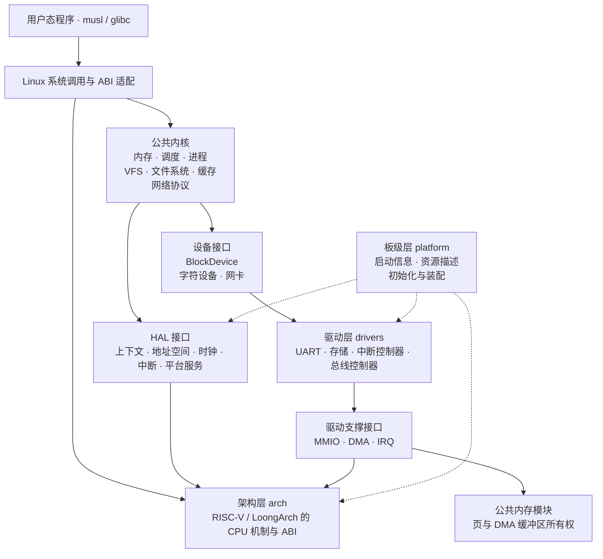

# 架构：公共内核与平台适配

这是目标设计，尚未全部实现。当前能力见 [README](../README.md)，区域赛交付范围以 [REGION-001](../specs/REGION-001.md) 为准。

## 各层怎样协作

实线表示运行时调用，虚线表示启动时配置或装配。HAL 是公共内核使用的平台接口；架构层、板级层和驱动层共同实现这些能力。

驱动支撑接口也是 HAL 的一部分。图中单列的公共内存模块属于公共内核，负责资源所有权；架构层负责映射与 CPU 机制。外部 IRQ 服务由已初始化的中断控制器驱动提供。服务按启动顺序注入，不得回调正在初始化的设备；HAL 不维护第二套调度器、分配器或设备注册表。

| 层 | 负责什么 | 交给其他层什么 |
| --- | --- | --- |
| 公共内核 | 分配/调度策略、进程生命周期、VFS、文件系统、缓存、协议栈 | 页表操作交架构层，硬件 I/O 交设备接口 |
| 架构层 | 寄存器、页表格式、TLB、异常入口、上下文、用户态 ABI 布局 | 板级地址与设备拓扑交板级层；调度决策交公共内核 |
| 板级层 | 固件入口、RAM/保留区、设备资源、启动顺序，选择并装配驱动 | 控制器寄存器操作交驱动；页表机制交架构层 |
| 驱动层 | 控制器协议、收发、完成与错误处理 | 从板级层取得资源，通过 HAL 申请映射/DMA/IRQ 服务 |

中断入口与 CPU 开关属于架构层；PLIC 等外部中断控制器属于驱动层；IRQ 连接关系属于板级层。时钟频率与来源由板级层描述，定时器访问由对应架构实现或设备驱动承担。设备时钟、复位、引脚由板级层编排，具体寄存器操作放相应驱动。

## 架构和板型分别选择

以下路径均相对 `kernel/src/`，是拟采用的模块归属，`platform/`、`drivers/` 尚待创建；实际文件树仍以 README 为准。

| 拟定位置 | 适配单位 |
| --- | --- |
| `arch/riscv64/`、`arch/loongarch64/` | CPU 架构；包含架构相关的 Linux ABI 转换 |
| `platform/qemu_riscv64/`、`platform/visionfive2/` | 同一 RISC-V 架构的两种机器 |
| `platform/qemu_loongarch64/`、`platform/xingyun_2k1000la/` | 同一 LoongArch 架构的两种机器 |
| `drivers/` | 按控制器/协议组织；同一驱动可被多个平台复用 |

每次构建选择一个 Rust 目标和一个板型，非法组合在构建阶段报错。架构选择集中在 `arch` 入口，板型选择集中在 `platform` 和构建配置；公共模块不判断板名。FS/VFS/缓存不得含架构条件编译，也不得直接依赖具体驱动或架构实现。

设备树、固件表或固定配置先转成统一启动/设备描述，再交给公共内核和驱动。早期可以静态装配，当前不要求动态总线框架；必须写清支持的固件、加载方式和资源来源。MM-002 的固定 QEMU 布局只适用于其约定环境，不能直接用于真板。

## 成员从哪里开始

| 要实现的能力 | 先读 | 第一份交付 |
| --- | --- | --- |
| 页表、异常、上下文 | [ARCH-001](../specs/ARCH-001.md) | 为当前一个调用场景补签名、失败行为和测试，再实现 |
| 新板启动与资源交接 | [PLAT-001](../specs/PLAT-001.md) | 核对固件入口、内存/保留区、UART、时钟、存储资源 |
| UART、VirtIO、SD 等设备 | [DRV-001](../specs/DRV-001.md) | 一个设备的初始化、成功与失败测试；块设备遵守 HAL-001 |

这三份是待审的边界规格；具体接口冻结在对应实现 SPEC 中，跨层变更由调用方和实现方共同审阅。移植顺序与环境验收见 [路线](roadmap.md#多平台怎样推进)。

分层参考 KernelX 的固定快照，借鉴范围及差异见 [来源](references.md#多平台设计参考)。
