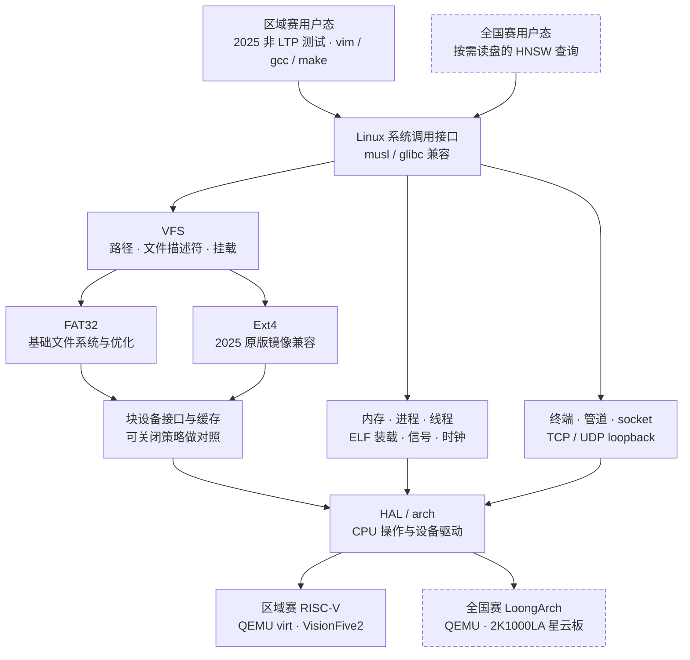

# 一次程序运行会经过哪些层

这是目标架构，图中的兼容层与存储层仍待实现。已验证的启动能力见 README 的当前状态；图不表示完成度。

## 读图的三个要点

- **程序兼容**：gcc 能运行需要加载器、进程、文件和内存共同正确；网络组还需要真实 socket 与回环收发。
- **文件系统**：FAT32 负责基础与优化实验，Ext4 读取并写回历史原版镜像；二者共享 VFS，分别验收格式行为。
- **平台移植**：页表、陷入与设备差异收敛到 HAL/arch；FS/VFS 无架构条件编译。全国赛将同一套上层实现搬到星云板。

AI 记忆检索提供后续压力负载。先测真实访问，再决定缓存或布局优化；全索引驻留内存的查询不能证明文件 I/O 收益。接口细节见 [模块边界](reference/delivery-details.md)。
